<p align="center">
  <a href="README.md">한국어</a> | <b>English</b> | <a href="README.ja.md">日本語</a>
</p>

<p align="center">
  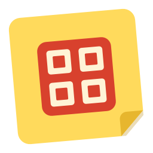
</p>

<h1 align="center">MemilMemo</h1>

<p align="center">
  <b>Desktop notes shared across your office PCs</b><br>
  Notes sync inside your local network only, never over the internet.
</p>

<p align="center">
  <a href="https://leeseunggyu8.github.io/MemilMemo/en/"><b>Download</b></a>
  &nbsp;&nbsp;|&nbsp;&nbsp;
  <a href="https://github.com/LEESEUNGGYU8/MemilMemo/releases">Release notes</a>
  &nbsp;&nbsp;|&nbsp;&nbsp;
  <a href="https://github.com/LEESEUNGGYU8/MemilMemo/issues">Support</a>
</p>

<p align="center">
  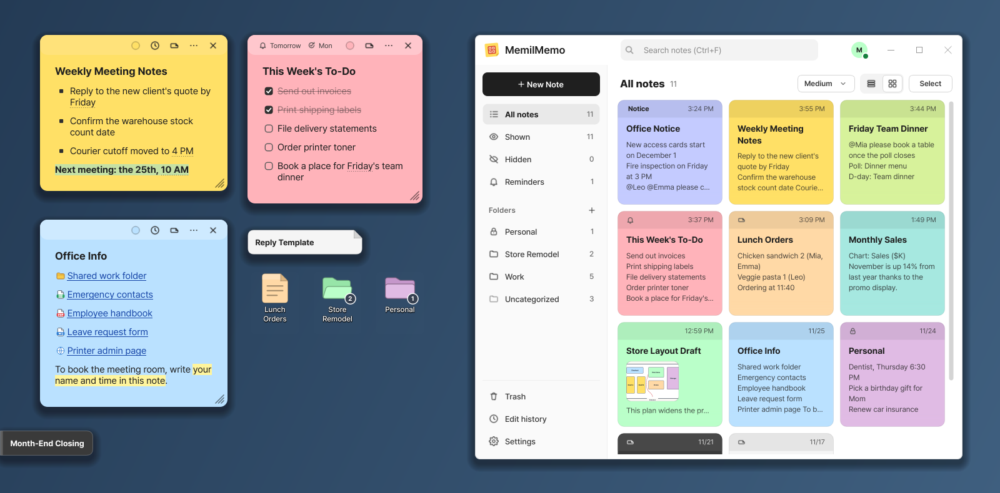
</p>

## Highlights

- **The same notes on every PC's desktop.** One PC starts sharing and the others join.
- **Real-time edit history and restore.** Shows who is editing a note, and restores any earlier point from the edit history.
- **Sync inside your local network only.** Notes are stored on the PC that starts sharing, and each PC that joins keeps a copy.
- **A password to limit who joins.** Set a password when you start sharing, and only the PCs that know it can join.

## Features

### Working together

See the participants, who is editing, and the edit history.

<p align="center">
  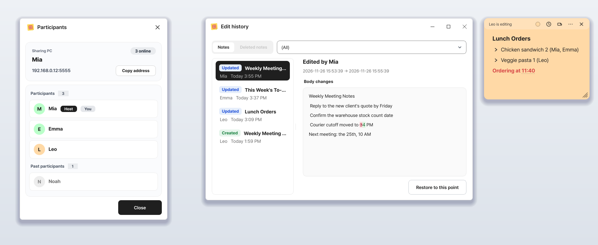
</p>

### Notices and @mentions

Make any note a notice to see who has read it, and mention participants.

<p align="center">
  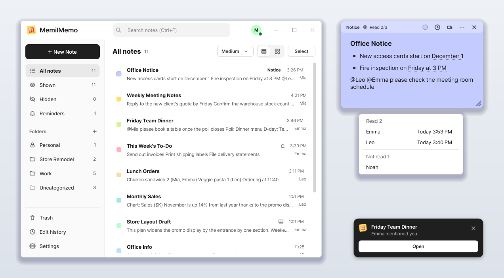
</p>

### Reminders

Set a reminder on a note to remind the people you choose at a set time and interval.

<p align="center">
  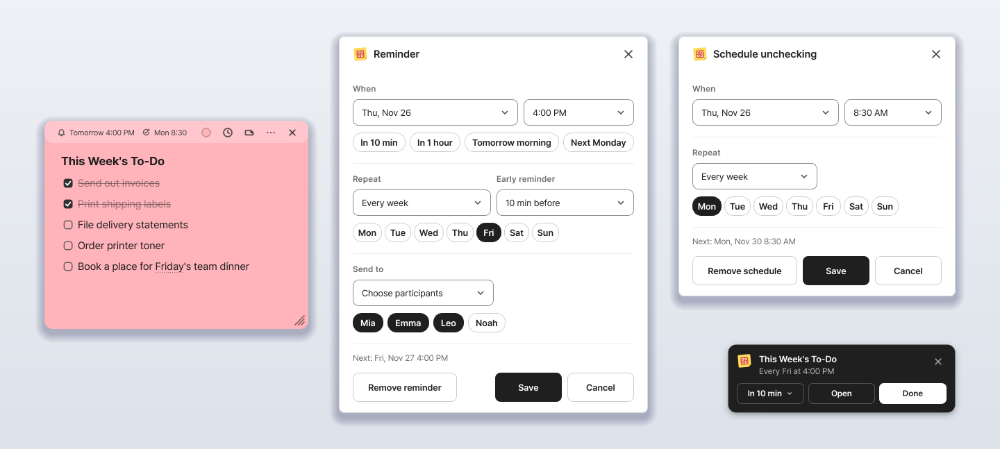
</p>

### Formatting and images

Use bold, text color, highlighter, bullets, to-do checkboxes, and tables. Paste images or drag them in.

<p align="center">
  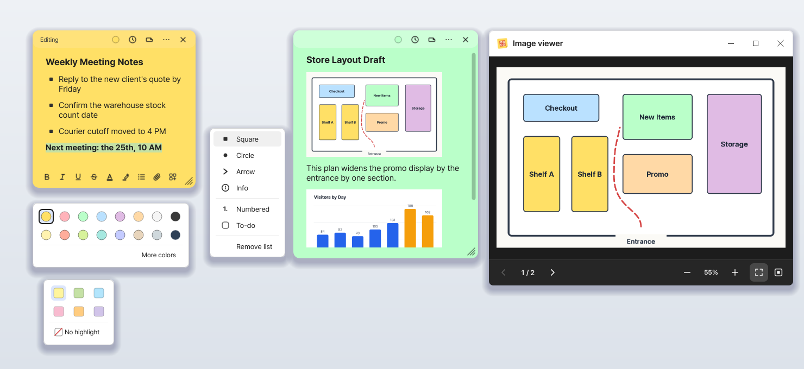
</p>

### Widgets

Create a variety of widgets inside a note and use them together.

<p align="center">
  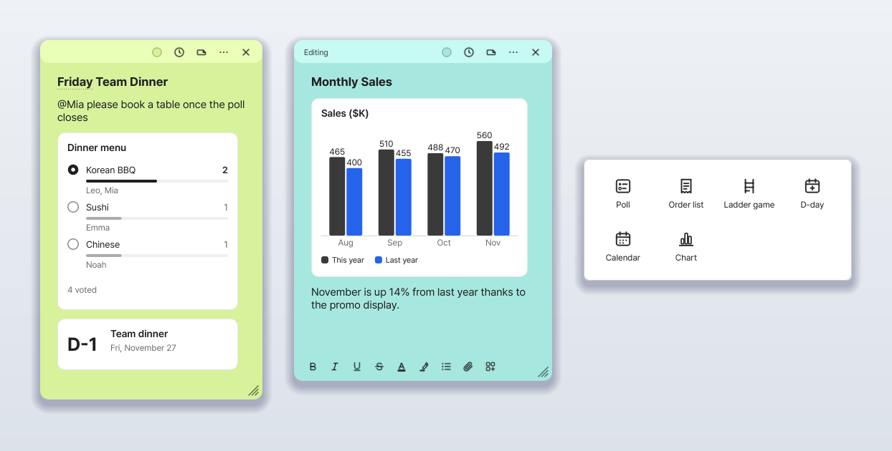
</p>

### Shortcuts to files and folders

Put files, folders, and web addresses into a note as links. Each link gets an icon for its type. Network paths to shared folders open on the other PCs too.

<p align="center">
  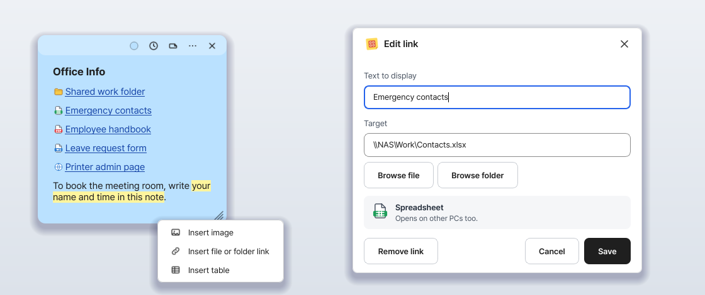
</p>

### Folding and docking

Fold a note into a slip or an icon. Drag it to the screen edge and it docks as a tab. Unfold it and it returns to where it was.

<p align="center">
  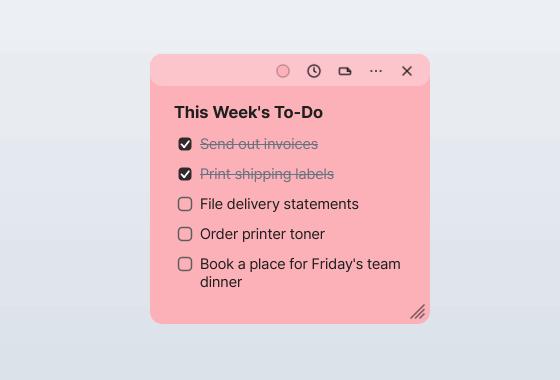
</p>

<p align="center">
  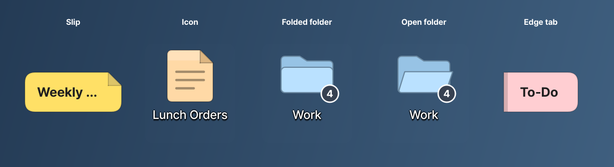
</p>

### List views

Choose Small, Medium, or Large, as a list or a grid.

<p align="center">
  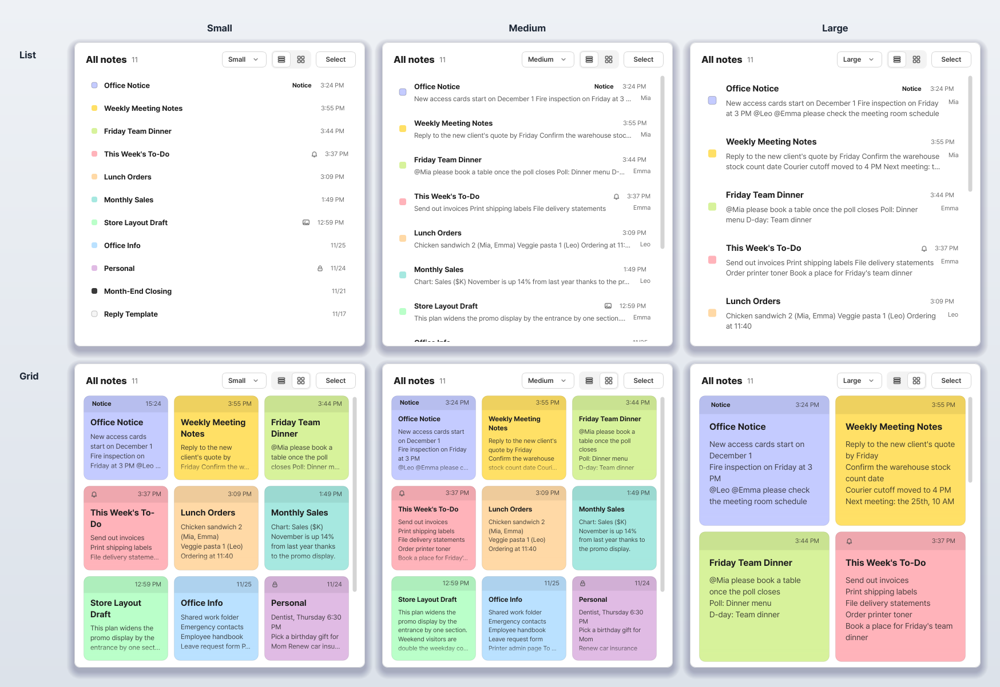
</p>

### More

- Folders, #tags, private notes, the Find window
- Use on this PC only, without sharing
- Notifications for new notes, edits, and notes made public
- Deleted notes restored from the history
- Automatic backup and restore
- While the sharing PC is off, reading your copy, writing notes, and taking over sharing from a copy
- A new note or note folder from the desktop right-click menu, and a new note from the taskbar
- A link note from a file's right-click menu
- Global shortcuts, and a new note from the clipboard
- Results for calculation lines, and totals and averages of selected numbers
- Print and PDF
- Attaching a note to a program window (experimental)
- Korean, English, Japanese

## Installation

1. **[Download MemilMemo](https://github.com/LEESEUNGGYU8/MemilMemo/releases/latest/download/MemilMemo-Setup.exe)** and run it.
2. On one PC, choose **Start sharing from this PC**.
3. On the other PCs, choose **Join notes on another PC** and pick the sharing PC it finds. If none appears, enter the address shown in the **Participants** window of the sharing PC.

> If Windows shows "Windows protected your PC", select **More info → Run anyway**.

SyncNotes becomes MemilMemo when you follow the update prompt in the app. Your notes stay as they are.

The app checks for new versions by itself. You can turn on automatic updates in Settings.

## Running from source

Python 3.10 or later and Windows are required.

```powershell
python -m pip install -r requirements.txt
python main.py
```

```powershell
python -m pytest tests -q
```

The README images are taken with demo data. The notes you are using are never captured.

```powershell
python tools/capture_screenshots.py --set readme --lang en --out docs/images/en
```

## License

MemilMemo is **freeware**, free to use. The source is published, but it is not under an open source license. [LICENSE.txt](LICENSE.txt)

The licenses of the bundled libraries (Qt, PySide6, Pretendard, and others) are in [THIRD-PARTY-NOTICES.txt](THIRD-PARTY-NOTICES.txt) and the `licenses/` folder.
