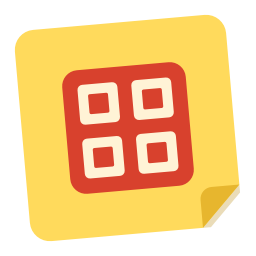
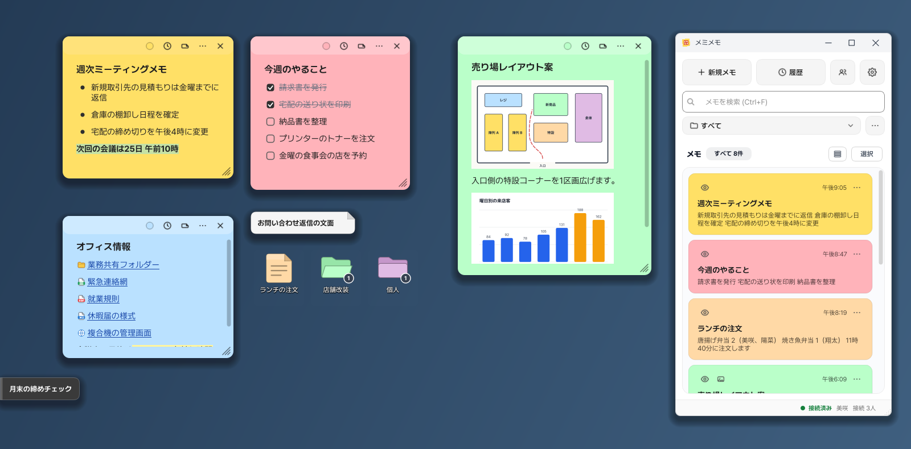
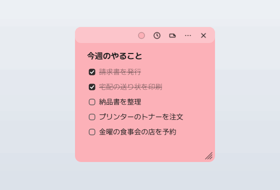
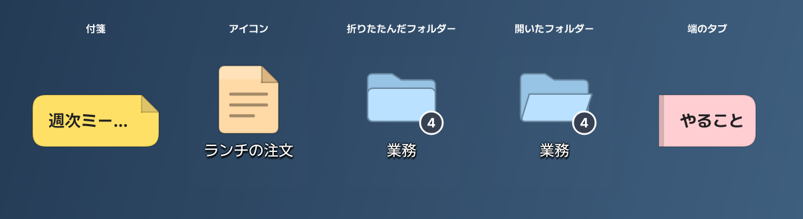
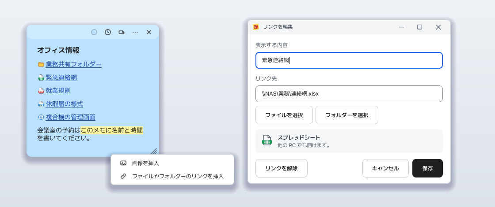
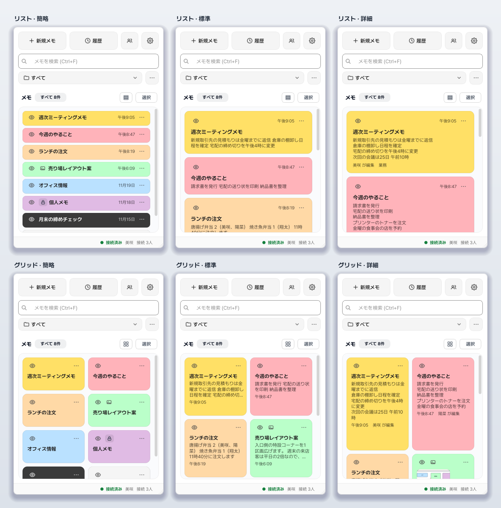
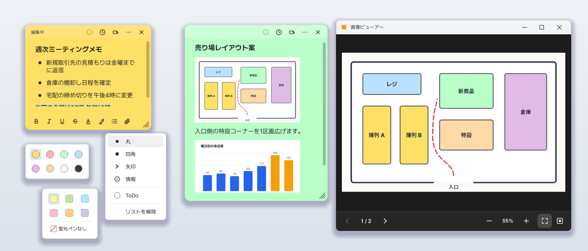
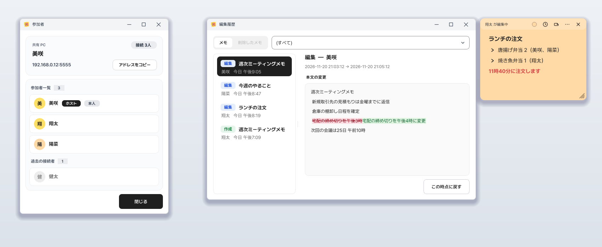

<p align="center">
  <a href="README.md">한국어</a> | <a href="README.en.md">English</a> | <b>日本語</b>
</p>

<p align="center">
  
</p>

<h1 align="center">メミメモ</h1>

<p align="center">
  <b>オフィスの PC 同士で一緒に使うデスクトップメモ</b><br>
  外部のインターネットには接続せず、社内ネットワークの中だけで同期します。
</p>

<p align="center">
  <a href="https://leeseunggyu8.github.io/MemilMemo/ja/"><b>ダウンロード</b></a>
  &nbsp;&nbsp;|&nbsp;&nbsp;
  <a href="https://github.com/LEESEUNGGYU8/MemilMemo/releases">更新履歴</a>
  &nbsp;&nbsp;|&nbsp;&nbsp;
  <a href="https://github.com/LEESEUNGGYU8/MemilMemo/issues">お問い合わせ</a>
</p>

<p align="center">
  
</p>

## 特長

- **すべての PC のデスクトップに同じメモを表示。** 1台の PC が共有を始め、ほかの PC が参加します。
- **編集履歴のリアルタイム確認と復元。** 編集中のユーザーを表示し、編集履歴から好きな時点に復元します。
- **社内ネットワークの中だけで同期。** メモは共有を始めた PC に保存し、参加した PC にコピーを置きます。
- **パスワードで参加を制限。** 共有を始めるときにパスワードを設定すると、知っている PC だけが参加できます。

## 機能

### 折りたたみと固定

メモを付箋やアイコンに折りたたみます。画面の端までドラッグするとタブとして固定され、開くと元の場所に戻ります。

<p align="center">
  
</p>

<p align="center">
  
</p>

### ファイルとフォルダーへのショートカット

ファイル、フォルダー、Web アドレスをリンクとして入れます。種類に合ったアイコンが付きます。共有フォルダーのネットワークパスは、ほかの PC でも開けます。

<p align="center">
  
</p>

### 一覧の表示

コンパクト、標準、詳細と、リスト、グリッドから選んで表示します。

<p align="center">
  
</p>

### 書式と画像

太字、文字色、蛍光ペン、箇条書き、やることのチェックが使えます。画像は貼り付けるか、ドラッグして入れます。

<p align="center">
  
</p>

### 一緒に使う

参加者、編集中の人、編集履歴を確認できます。

<p align="center">
  
</p>

### そのほか

- フォルダー、自分のみ表示、検索
- 新規メモ、編集、公開への切り替えの通知
- 削除したメモを履歴から復元
- 自動バックアップと復元
- 共有 PC が停止しているあいだのコピーの閲覧とメモの作成、コピーからの共有の引き継ぎ
- デスクトップの右クリックから新規メモとメモフォルダー、タスクバーから新規メモ
- ファイルの右クリックからリンク入りのメモ
- 韓国語、英語、日本語

## インストール

1. **[メミメモをダウンロード](https://github.com/LEESEUNGGYU8/MemilMemo/releases/latest/download/MemilMemo-Setup.exe)** して実行します。
2. 1台の PC で **この PC で共有を始める** を選びます。
3. ほかの PC で **他の PC のメモに参加** を選び、見つかった共有 PC を選びます。表示されないときは、共有 PC の **参加者** ウィンドウにあるアドレスを入力します。

> Windows が「Windows によって PC が保護されました」と表示したら、**詳細情報 → 実行** を選んでください。

SyncNotes は、アプリのアップデート案内に従うとメミメモに切り替わります。メモはそのまま残ります。

新しいバージョンはアプリが自動で確認します。設定で自動アップデートを有効にできます。

## ソースから実行

Python 3.10 以上と Windows が必要です。

```powershell
python -m pip install -r requirements.txt
python main.py
```

```powershell
python -m pytest tests -q
```

README の画像はデモデータで撮影します。使用中のメモは写りません。

```powershell
python tools/capture_screenshots.py --set readme --lang ja --out docs/images/ja
```

## ライセンス

無料で使える **フリーウェア** です。ソースは公開していますが、オープンソースライセンスではありません。[LICENSE.txt](LICENSE.txt)

同梱しているライブラリ (Qt、PySide6、Pretendard など) のライセンスは [THIRD-PARTY-NOTICES.txt](THIRD-PARTY-NOTICES.txt) と `licenses/` フォルダーにあります。
