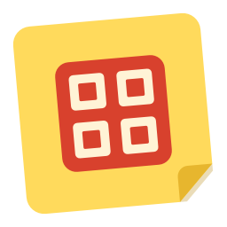
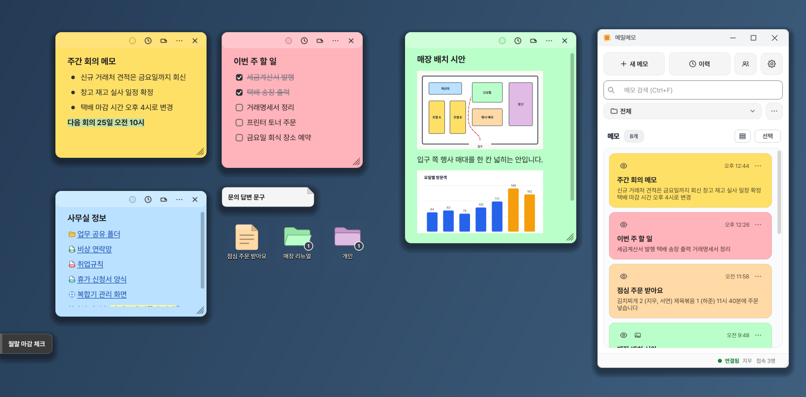
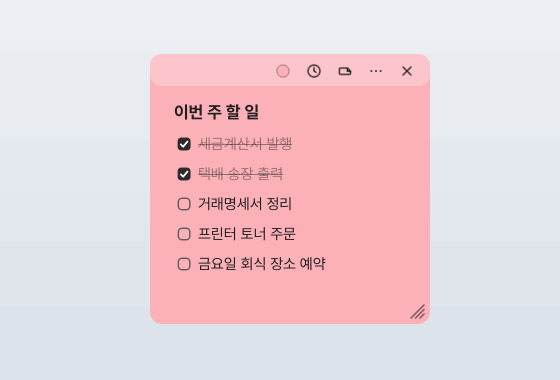
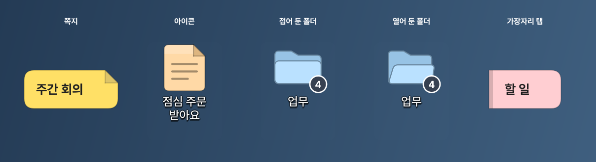
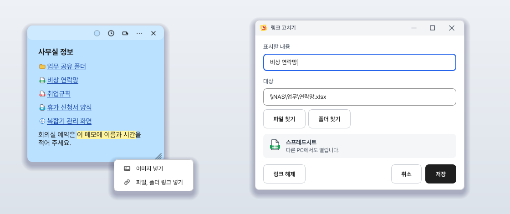
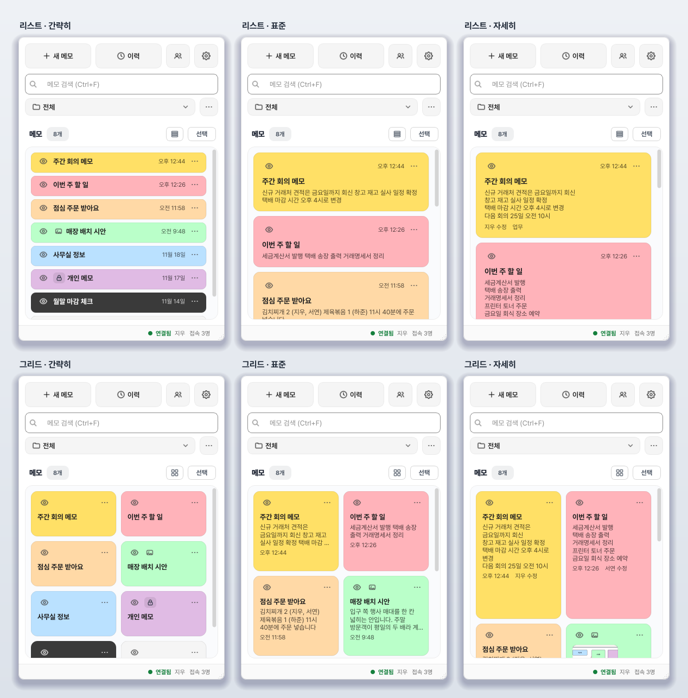
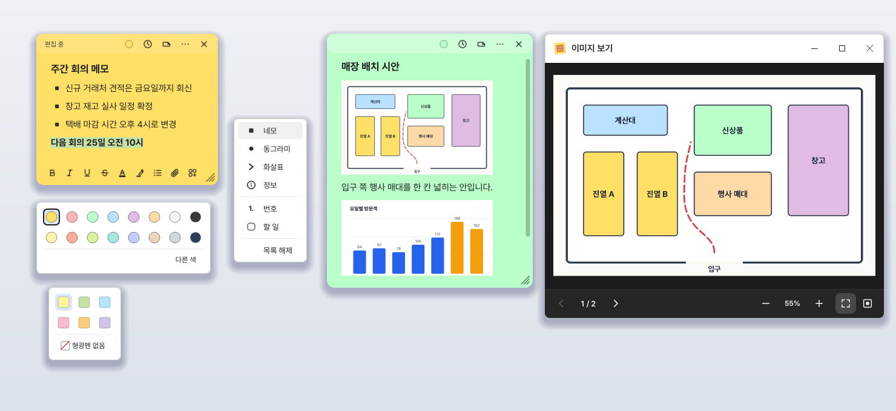
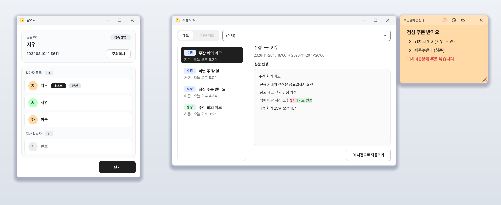

<p align="center">
  
</p>

<h1 align="center">메밀메모</h1>

<p align="center">
  <b>사무실 PC끼리 같이 쓰는 바탕화면 메모</b><br>
  외부 인터넷 접속 없이 내부망 안에서만 동기화됩니다.
</p>

<p align="center">
  <a href="https://leeseunggyu8.github.io/MemilMemo/"><b>내려받기</b></a>
  &nbsp;&nbsp;|&nbsp;&nbsp;
  <a href="https://github.com/LEESEUNGGYU8/MemilMemo/releases">변경 내역</a>
  &nbsp;&nbsp;|&nbsp;&nbsp;
  <a href="https://github.com/LEESEUNGGYU8/MemilMemo/issues">문의</a>
</p>

<p align="center">
  
</p>

## 특징

- **모든 PC의 바탕화면에 같은 메모 표시.** PC 한 대가 공유를 시작하고 나머지가 참여합니다.
- **메모 이력 실시간 확인 및 복원.** 편집 중인 사용자를 표시하고, 수정 이력에서 원하는 시점으로 복원합니다.
- **내부망 안에서만 동기화.** 메모는 공유를 시작한 PC에 저장하고, 참여한 PC에 사본을 둡니다.
- **비밀번호로 참여 제한.** 공유를 시작할 때 비밀번호를 걸면 아는 PC만 참여합니다.

## 기능

### 접어서 붙이기

메모를 쪽지나 아이콘으로 접습니다. 화면 끝으로 끌면 탭으로 붙고, 펴면 원래 자리로 돌아옵니다.

<p align="center">
  
</p>

<p align="center">
  
</p>

### 파일과 폴더 바로 가기

파일, 폴더, 웹 주소를 링크로 넣습니다. 종류에 맞는 아이콘이 붙습니다. 공유 폴더의 네트워크 경로는 다른 PC에서도 열립니다.

<p align="center">
  
</p>

### 목록 보기

간략히, 표준, 자세히와 리스트, 그리드 가운데 골라 봅니다.

<p align="center">
  
</p>

### 서식과 이미지

굵게, 글자 색, 형광펜, 글머리, 할 일 체크를 씁니다. 이미지는 붙여 넣거나 끌어다 놓습니다.

<p align="center">
  
</p>

### 함께 쓰기

참가자, 편집 중인 사람, 수정 이력을 봅니다.

<p align="center">
  
</p>

### 그 밖에

- 폴더, 나만 보기, 검색
- 새 메모, 수정, 공개 전환 알림
- 삭제한 메모를 이력에서 되살리기
- 자동 백업과 복원
- 공유 PC가 꺼져 있을 때 사본 읽기와 메모 쓰기, 사본으로 공유 이어받기
- 바탕화면 우클릭으로 새 메모와 메모 폴더, 작업 표시줄에서 새 메모
- 파일 우클릭으로 링크 메모
- 한국어, 영어, 일본어

## 설치

1. **[메밀메모 내려받기](https://github.com/LEESEUNGGYU8/MemilMemo/releases/latest/download/MemilMemo-Setup.exe)** 후 실행합니다.
2. 한 PC에서 **이 PC에서 공유 시작**을 고릅니다.
3. 다른 PC에서 **다른 PC의 메모에 참여**를 고르고, 찾은 공유 PC를 고릅니다. 나오지 않으면 공유 PC의 **참가자** 창에 있는 주소를 넣습니다.

> Windows가 "PC 보호" 창을 띄우면 **추가 정보 → 실행**을 누르세요.

SyncNotes는 프로그램의 업데이트 안내를 따르면 메밀메모로 바뀝니다. 메모는 그대로 남습니다.

새 버전은 프로그램이 알아서 확인합니다. 설정에서 자동 업데이트를 켤 수 있습니다.

## 소스에서 실행하기

Python 3.10 이상과 Windows가 필요합니다.

```powershell
python -m pip install -r requirements.txt
python main.py
```

```powershell
python -m pytest tests -q
```

README 그림은 데모 데이터로 찍습니다. 사용 중인 메모는 찍히지 않습니다.

```powershell
python tools/capture_screenshots.py --set readme
```

## 라이선스

무료로 쓰는 **프리웨어**입니다. 소스는 공개하지만 오픈소스 라이선스는 아닙니다. [LICENSE.txt](LICENSE.txt)

함께 배포하는 라이브러리(Qt, PySide6, Pretendard 등)의 라이선스는 [THIRD-PARTY-NOTICES.txt](THIRD-PARTY-NOTICES.txt)와 `licenses/` 폴더에 있습니다.
